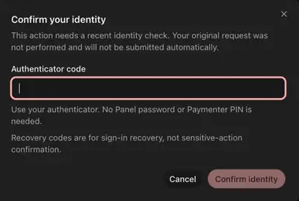

Manage runtime account protection under **Account → Settings** at [cloud.8labs.id](https://cloud.8labs.id). Use your own account and keep recovery material private.

## Audience, availability, and prerequisites

These actions affect your own runtime account. They do not establish or change credentials for the billing portal at my.8labs.id.

Before enabling two-factor authentication, prepare a TOTP authenticator and secure storage separate from that device. Sensitive changes use the identity method selected below.

Hosted configuration controls password recovery and session-list availability. A missing recovery control does not mean public registration or invitations have the same availability.

## Confirm your identity for sensitive changes

- **TOTP enabled:** enter the fresh six-digit authenticator code. No Panel password or Paymenter PIN is needed. Recovery codes are for sign-in, not this confirmation.
- **Linked Paymenter account without TOTP:** use the purpose-specific PIN flow when the matching service and billing-portal generator are available.
- **Unbound native account without TOTP:** confirm the current Panel password. This is not a fallback for an unavailable linked-account PIN.

Before initial TOTP setup, TOTP is not yet active. A linked account therefore needs the available matching-service PIN approval before setup can continue. Do not assume possession of an authenticator alone approves initial setup.

Confirm a sensitive action with an authenticator code, then return to the form and explicitly save.

The hosted Paymenter PIN generator is not currently available. Contact [support](/docs/help/contact) if the selected method requires it. The steps below describe the supported flow once the matching service and generator are available. Panel support alone does not establish billing-portal availability. Do not use password or email recovery to bypass the required approval.

1. Request approval in the Panel identity dialog for the intended action and matching service.
2. Open that same service in your billing account and generate its eight-digit PIN, if available.
3. Enter the PIN in the original Panel browser session before the displayed deadline.
4. Return to the original form, review it, and explicitly select **Save** or the intended action again.

The original approval expires after ten minutes. Regenerating its PIN replaces the previous PIN without extending that deadline. Confirmed identity proof lasts at most five minutes. PIN-backed proof also ends at the original request deadline or after one successful protected write, whichever occurs first. Approval does not save the form or replay a rejected request. Account-password approval cannot authorize API-key management or another sensitive purpose.

## Change your password

1. Open **Account → Settings → Password**.
2. Complete identity confirmation for the account-password purpose using the method above.
3. Enter and confirm the new password. Enter the current password only when the native-account form requires it.
4. Explicitly select **Save** after approval, then wait for confirmation or the sign-in page.
5. Sign in again with the new password.

Changing the password signs you out. Other browsers with stale sessions must also sign in again. Use a unique password that meets the displayed requirements.

### Recover a forgotten password

Email recovery is currently unavailable on the hosted sign-in page. Contact [support](/docs/help/contact) for recovery guidance. Other deployments can provide **Forgot your password?** when recovery is enabled.

1. Open that link and enter the email associated with your runtime account.
2. Submit the request and check that mailbox, including spam.
3. Open the reset link and set a new password.
4. Sign in again with the new password.

The documented reset link is single-use and valid for one hour. Recovery also requires working email delivery. No email is guaranteed when the hosted service has recovery disabled or mail delivery unavailable.

If the link is missing, expired, or no message arrives, contact [support](/docs/help/contact). Do not send your password or reset link. A password reset does not replace a lost second factor.

## Use two-factor authentication

Two-factor authentication adds a six-digit TOTP code after your password at sign-in. Compatible apps include Google Authenticator, 1Password, and Aegis.

### Enable two-factor authentication

1. Open **Account → Settings → Two-factor authentication → Turn on**.
2. Complete identity confirmation using the method above, then return to the card and continue.
3. Scan the QR code with your authenticator, or enter the displayed setup key manually.
4. Enter the six-digit code from the app and select **Confirm**.
5. Wait for successful confirmation and store the recovery codes securely.

The second factor becomes active only after a valid code is confirmed. Closing an unfinished setup does not enable it. Treat the QR code and setup key as secrets; do not share screenshots.

### Store and replace recovery codes

Each recovery code signs you in once and is consumed when used. Store codes separately from the device holding your authenticator.

Use **Recovery codes** to view the current set after identity confirmation. Use **Regenerate codes** to replace the entire set after confirmation. With TOTP enabled, use an authenticator code, not your password or a recovery code. Replace your stored copy immediately. Do not rely on the old set.

Viewing codes is a protected read. Regeneration is a protected write that invalidates the old set. Complete any requested confirmation, then explicitly repeat the intended view or regeneration action. A protected read does not consume a PIN's single protected-write allowance.

If you lose both the authenticator and the recovery codes, contact support for operator-assisted recovery. Recovery requires identity checks; do not assume immediate access or a bypass.

### Sign in with a second factor

After entering your password, enter the current authenticator code. If the authenticator is unavailable, choose **Lost your device? Use a recovery code** and enter an unused saved code.

If codes fail, check the authenticator device's time and use a fresh code. Do not repeatedly share or submit recovery codes through support channels.

### Disable two-factor authentication

Choose **Turn off** on the same card and complete identity confirmation with the current authenticator code. Sensitive confirmation also protects setup and recovery-code management. Return to the card and explicitly continue after approval.

Disabling removes that sign-in protection. Do it only when necessary, and restore protection after changing authenticator devices.

## Review active browser sessions

Where supported, **Active sessions** lists signed-in browsers with their IP address and last activity. You can revoke another session, but not the current session from this list.

1. Open **Account → Settings → Active sessions**.
2. Review the entries and revoke browsers you do not recognize.
3. Wait for the list to update.
4. Change your password if access is suspicious.

Revoking one or all other sessions requires sensitive identity confirmation. Complete the selected method, then explicitly repeat the intended revocation. Reading the session list does not itself revoke anything.

Session listing and revocation require the panel's database-backed session configuration. Other configurations show an advisory instead of the list. Customers do not need to change platform configuration themselves.

### Understand a stale-session sign-in prompt

The panel compares the session's stored password hash with the current account hash. A mismatch redirects the browser to sign-in instead of leaving a 401 error.

This can follow a password change on another device or a browser previously signed into another account. Signing in again refreshes the session. This protection also applies when session listing is unavailable.

If unexpected sign-in prompts continue, note the time and error, then contact support. Do not send session cookies.

## Manage SSH public keys

Open **Workspace → SSH Keys** in the sidebar to manage the saved public-key list.

Adding and removing saved SSH keys also require sensitive identity confirmation. After approval, explicitly repeat the intended add or remove action.

Account SSH keys store **public** keys that can be selected during deployment, where supported, instead of using a root password. See [SSH access](/docs/getting-started/ssh) and [accessing Virtual Labs](/docs/getting-started/accessing-virtual-labs).

Never upload your private SSH key. Do not assume changing an account's stored public keys automatically changes an already deployed server's authorized keys.

### Add or remove a saved public key

1. Locate the single OpenSSH public key on your own device, usually in a `.pub` file.
2. Open **Workspace → SSH Keys → Add key**.
3. Enter a recognizable **Name** and paste the single line into **Public key**.
4. Submit once and wait for the success message and updated list.
5. Compare the displayed fingerprint with your local public key before using it.

Run `ssh-keygen -lf ~/.ssh/id_ed25519.pub` on your computer if that is your public key's actual path.
If validation fails, check the public-key format. Do not paste a private key or several keys into the single-key field.

To remove a saved key, use its remove control, check **Remove SSH key**, and confirm the intended entry.
Wait until it disappears from the list. Replace a saved key by adding the replacement before removing the old entry.
Removal does not revoke a key already installed inside a guest. Update affected guest accounts separately with a working recovery session.
If a private key leaks, remove its corresponding guest authorization and replace it. Deleting only this saved public key is insufficient.

## Suspected account compromise

Revoke unfamiliar browser sessions, change your password, and review [API keys](/docs/account/api-keys) and [team access](/docs/teams/overview). Browser-session revocation is not API-key revocation.

Contact [8Labs support](/docs/help/contact) promptly if you cannot regain control. Share your account identifier, timestamps, and redacted errors. Never share passwords, TOTP setup material, recovery codes, tokens, or cookies.

## Related guides

- [Personal API keys](/docs/account/api-keys)
- [Notification subscriptions](/docs/account/notifications)
- [Invitations and registration](/docs/teams/invitations)
