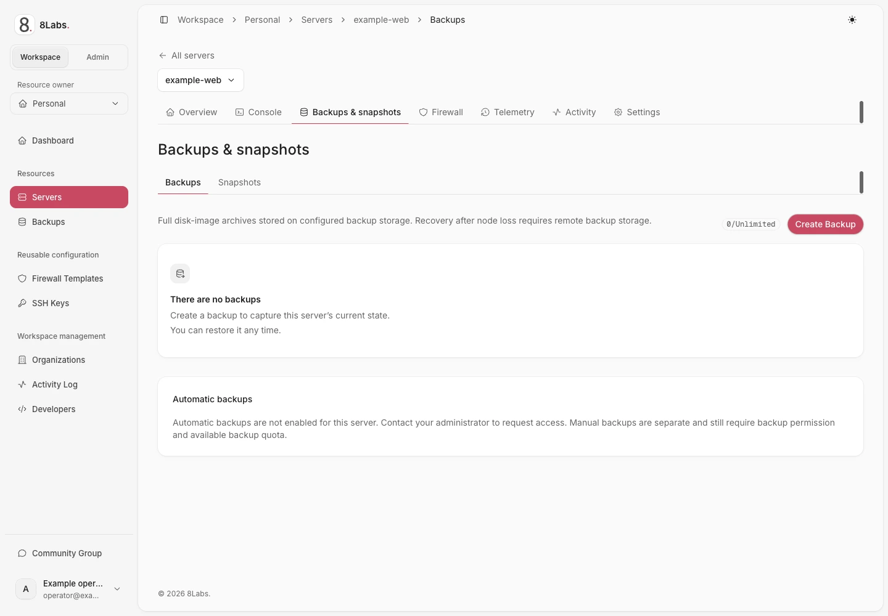

A backup captures server disk state through the hypervisor. Use a completed backup as a recovery point before risky changes.

**Restoring overwrites the server's current disk state. Writes after the recovery point are lost. There is no undo.** Confirm the server and preserve newer data elsewhere first.

_Backup list and automatic backup availability._

## Audience, permissions, and prerequisites

This guide is for owners and authorized collaborators at [cloud.8labs.id](https://cloud.8labs.id). Backup storage, export, quota, and scheduling depend on the hosted service and server entitlement.

- `backup.read` permits viewing backups and requesting an available export.
- `backup.write` permits creation, deletion, and schedule changes.
- `backup.restore` permits restoration. Stopping or starting requires separate power access.

Check your quota and the intended server. Arrange application-consistent data handling with your application administrator. Do not assume a disk backup captures remote databases or external volumes.

Storage location and durability are operator-configured. A backup is not automatically an off-site copy. Ask support about your service's storage and recovery coverage.

## Take a manual backup

1. Open the server and select **Backups → Create Backup**.
2. Enter a recognizable name, up to 40 characters.
3. Review **Compression Type** and **Mode**.
4. Select **Create** once and wait for the background task.
5. Confirm successful completion before treating the backup as recoverable.

The form offers **None**, **LZO**, **GZip**, and **ZSTD** compression. **Snapshot** is a backup mode, not a disk-chain snapshot from the separate **Snapshots** page. **Suspend** and **Kill** can interrupt workloads; **Kill** requests a stopped backup. Use a maintenance window when interruption is unacceptable.

A submitted request or visible pending row is not a completed backup. Success requires the hypervisor task to succeed and its exact archive to be found on backup storage. Storage visibility can lag task completion.

### Quota and request limits

| Limit               | Meaning                                                                                                                              |
| ------------------- | ------------------------------------------------------------------------------------------------------------------------------------ |
| Zero backup limit   | Creation is disabled. Ask support about available entitlement.                                                                       |
| Finite backup limit | Remove an eligible, unnecessary backup or request a limit change. Do not delete your only verified recovery point.                   |
| Unlimited count     | No configured count cap; storage capacity and other restrictions still apply. It does not enable automatic backups.                  |
| Usage unavailable   | The panel does not assume zero usage. Resolve loading errors before creating a backup.                                               |
| Request rate limit  | A burst guard limits repeated creation requests; the source default is two requests per ten minutes, but hosted settings can differ. |

Existing archives remain visible when quota or automatic-backup entitlement changes. Manual creation has no scheduled-run fee in the reviewed implementation; consult your service terms for applicable charges.

## Restore a completed backup

**Stop here if you cannot accept losing newer data.** Restoration targets this server, not a separate preview server.

1. Verify the server identifier, backup name, creation time, and successful completion.
2. Copy any newer required data to a separate safe location.
3. Shut down the server and wait until it is **Stopped** and idle.
4. Open the backup's **⋯** menu and select **Restore**.
5. Read the confirmation and approve only the intended recovery point.
6. Wait until restoration finishes and the transitional status clears.
7. Confirm the power state before starting the server, then inspect the application and data through the console.

Only a successful, completed backup belonging to this server with a recorded archive filename is eligible. A failed, unfinished, mismatched, or missing-archive record must not be forced through.

An accepted restore request means restoration started, not that recovery succeeded. If it fails or remains in progress, avoid further destructive actions and contact support.

## Download an available export

When export is configured, a successful backup's **⋯ → Download** requests a temporary object-storage link. The transfer goes directly to storage, not through the panel.

Use the link promptly. The reviewed default lifetime is about one hour; hosted configuration can differ. Treat the URL as a secret because it can grant access to the archive.

If the link expires, request another through the panel. No **Download** entry can mean export is unavailable. Do not infer that a visible backup always has a downloadable export.

Keep downloaded archives in access-controlled storage. Confirm the transfer completed before relying on the copy; ask support about supported recovery procedures for an exported archive.

## Configure automatic backups

Automatic backups require explicit administrator enablement **for each server**. An unlimited quota or access to an account-wide backup list does not grant scheduling entitlement.

1. Open the server's **Backups** page and locate **Automatic backups**.
2. Confirm entitlement, quota, and any displayed per-run price.
3. Turn on **Run automatic backups**.
4. Select daily, weekly, or monthly frequency.
5. Set **Hour (UTC)** and the applicable weekday or monthly date.
6. Choose how many scheduled backups to keep, then select **Save**.
7. Confirm the next run, then check the resulting backup after that time.

Monthly dates are limited to 1–28. Retention cannot exceed the finite backup limit, or 50 when the count is unlimited. A zero limit still disables backup creation.

Runs are hourly-granular. A 03:00 schedule runs on the first scheduled pass at or after that hour, not at a guaranteed exact minute.

### Retention and archive safety

Old recovery points are removed only after the replacement succeeds and its exact archive is verified on storage. Submission failure, full storage, task failure, and monitor timeout do not authorize early deletion.

Manual, locked, and unfinished backups are not automatic-retention victims.
At a full quota, one scheduled replacement can temporarily use one extra slot.
This requires an unlocked, successful scheduled backup that can be replaced, with no pending backup.

Storage must physically hold both archives. The panel does not delete the old archive first to create space. Manual requests retain normal quota and rate limits.

Each run captures its retention target and oldest eligible records before starting. Later schedule changes or removal cannot enlarge that deletion set. Cleanup never targets the replacement itself.

Protected backups can leave counts above target. If old and new records name the same archive, retention preserves it rather than risk deleting the replacement. Ask support to reconcile duplicate records.

Cleanup failure does not change a verified backup to failed. Monitoring retries cleanup; support can resume an exhausted job using the same captured deletion set. Do not manually delete archives to repair a count.

If entitlement is revoked, future runs are skipped without a new backup, wallet charge, or archive deletion. The saved schedule and existing recovery points remain. You can disable the saved schedule; enabling again requires renewed entitlement. An already accepted run may finish with its captured retention policy.

### Understand optional scheduled-run billing

When enabled for the service, the schedule card shows a per-run fee before activation. The wallet that pays for the server is charged at submission, not after archive verification.

If that wallet cannot cover the fee, the run is skipped: no backup and no charge. Replenish the correct payer balance through the supported billing process, then check the next run.

A failed submitted run does **not** trigger an automatic refund. Contact support for review. Use [my.8labs.id](https://my.8labs.id) for customer billing; do not assume its balance or sign-in is interchangeable with a runtime-panel wallet.

## Diagnose backup problems

| Symptom                             | Safe next action                                                                                                                                                                           |
| ----------------------------------- | ------------------------------------------------------------------------------------------------------------------------------------------------------------------------------------------ |
| “Too many backups”                  | Review count and quota. Remove only an unnecessary eligible backup, or ask support to increase the limit.                                                                                  |
| Creation disabled while usage loads | Wait or reload once. A failed usage request is not zero usage.                                                                                                                             |
| Backup unfinished for hours         | Record its ID and start time. Ask support to check task and archive visibility before resubmitting. Stalled-record handling defaults to six hours in the source, not a completion promise. |
| Task succeeded but row is pending   | Exact archive verification may still be pending. Keep previous recovery points; ask support if it persists.                                                                                |
| Backup failed                       | Preserve the last verified backup. Record the error and time; ask support about storage or hypervisor failure.                                                                             |
| No **Download**                     | Check completion and access. Export may not be configured for the hosted service.                                                                                                          |
| Download link expired               | Request a fresh link. Do not post the old URL in a public issue.                                                                                                                           |
| Restore rejected                    | Check server ownership of the backup, successful completion, archive record, stopped state, idle status, and permission.                                                                   |
| Scheduled runs stopped              | Check per-server entitlement, zero/full quota, pending jobs, schedule UTC time, and payer balance if fees apply.                                                                           |
| Retention count stays high          | Protected or duplicate records, or cleanup retries, can prevent the target. Ask support; do not delete storage objects yourself.                                                           |

Send [8Labs support](/docs/help/contact) the server and backup identifiers, UTC time, status, and exact error. Never send archive links, passwords, private keys, or unredacted sensitive contents.

## Related guides

- [Snapshots are not external backups](/docs/servers/snapshots)
- [Server power actions](/docs/servers/power)
- [Server settings and destructive actions](/docs/servers/settings)
- [Billing and plans](/docs/billing-plans/overview)
- [Troubleshooting](/docs/troubleshooting/overview)
