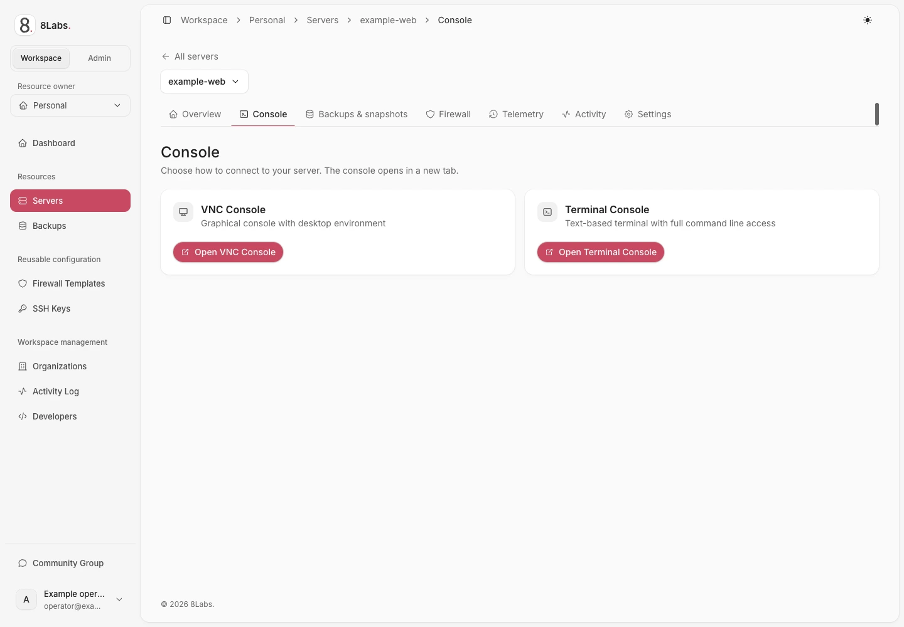

**Audience:** a server user with `control.console` or an effective permission that includes console access.
**Availability:** the operator must configure a console broker and the server must support the requested console type.

## Before you open a console

The browser console connects to the virtual machine through its host. It is not SSH and does not require guest SSH networking.
It still depends on a reachable host, the console service, and a valid Panel session.
A console login uses the guest operating system account, not your Cloud Panel password.
A key-only Linux image may have no password login. Do not enable root password access merely to obtain a console prompt.

## Open a session

1. Open [Cloud Panel](https://cloud.8labs.id).
2. Open **Servers** and select the intended server.
3. Open **Console**.
4. Choose graphical **VNC** or **Serial** if the options are offered.
5. Allow the console window only for the trusted Panel site if your browser blocks it.
6. Wait for the connection state before entering guest input.
7. Authenticate to the guest if its login prompt appears.

The Panel supplies a short-lived launch credential to the configured console service.
The launcher removes the credential from its address before session setup. Never copy or share a launch URL.
An established session can continue after launch validity expires. A new connection after expiry requires a fresh Panel launch.
Do not bookmark the console launch address; bookmark the server page instead.

_Sanitized production UI — read-only observation — LabsPanel v5.3.15. Console chooser only: VNC Console and Terminal Console. Neither launch button was pressed and no guest session was opened. English UI labels; Indonesian text is caption translation only._

## Choose the correct console

**VNC** shows the guest's graphical display. It can show firmware, a graphical desktop, or a text login screen.
**Serial** shows the configured guest serial terminal. A blank view can mean the guest does not provide a serial login.
Neither option promises that the guest is running or that credentials are configured.
Use the connection and error states to distinguish a disconnected transport from an empty guest display.

## Keyboard, clipboard, and display

Click inside the display before typing. Browser and operating system shortcuts can be intercepted before reaching the guest.
Use only the keyboard helpers actually shown by the console. Do not assume every local shortcut reaches the guest.
Clipboard access depends on browser permissions and console support. Paste only material you intend to execute in the guest.
Never paste a password or command without checking the focused destination.
Use available scale or fit controls for VNC; they change the display, not the guest resolution or server resources.

## Expired or disconnected session

| State                      | Next action                                                                                  |
| -------------------------- | -------------------------------------------------------------------------------------------- |
| Missing or invalid launch  | Close the console and open it from the authorized server page.                               |
| Launch expired             | Return to Panel and request a new console session.                                           |
| Connection interrupted     | Use reconnect if offered while the session remains valid. Otherwise launch again from Panel. |
| Serial view empty          | Confirm serial support for the image. Use VNC if supported.                                  |
| Panel access denied        | Ask the owner to review effective console permission.                                        |
| Host or broker unavailable | Contact support; changing guest SSH settings will not repair the broker.                     |

A direct Panel broker path may be used on some deployments. Follow the displayed controls rather than editing console URLs.
Closing the console disconnects that browser view; it does not shut down the server or log out every guest session.

## Report a console problem safely

Send the time, browser version, selected console type, visible connection state, and redacted error to [support](/docs/help/contact/).
Do not send the launch URL, browser cookies, storage exports, console ticket, JWT, or raw network capture.
Crop terminal content and identity details before sharing a screenshot.

[SSH connection](/docs/getting-started/ssh/) · [Power controls](/docs/servers/power/) · [Recovery](/docs/troubleshooting/overview/)
