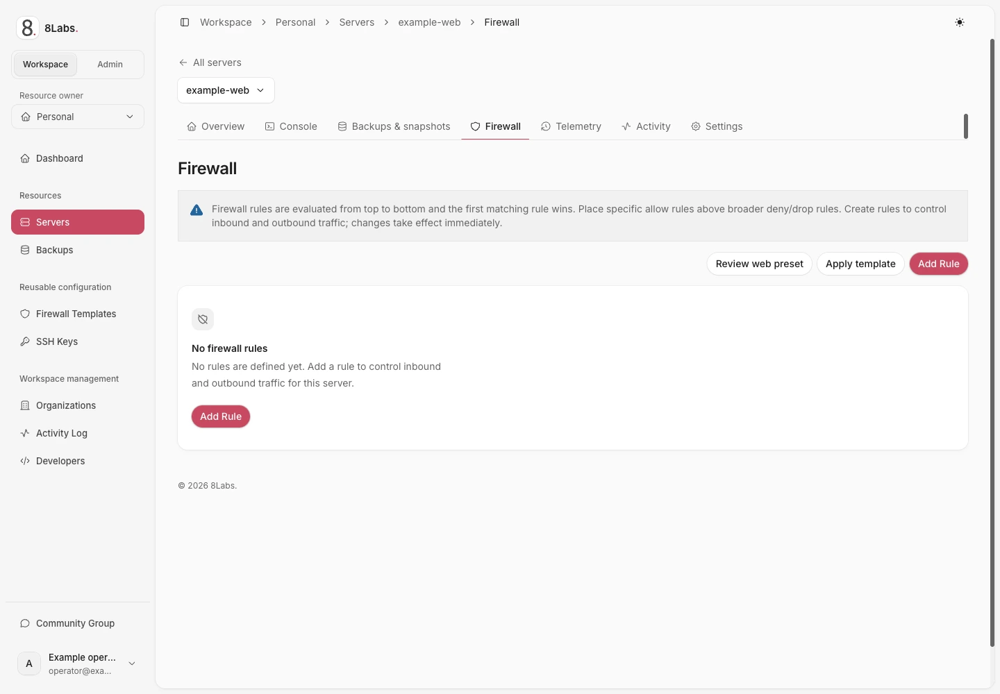

**Firewall changes take effect immediately and can disconnect you. Confirm working console access before any edit, template, or preset.** An existing SSH or RDP session is not a recovery console.

_Sanitized production UI — read-only observation — LabsPanel v5.3.15. Observed Firewall empty state and rule-order warning. No rule or template was applied. English UI labels; Indonesian text is caption translation only._

## Audience, permissions, and prerequisites

This guide is for owners and collaborators authorized to manage a server at [cloud.8labs.id](https://cloud.8labs.id). Mutations require `firewall.manage`; hosted controls can vary.

Before proceeding:

- Open and test the [server console](/docs/servers/console).
- Record existing rules and confirm the inbound and outbound default policies with support if unknown.
- Confirm the management protocol, actual guest port, and trusted source addresses.
- Check the guest firewall and service configuration separately.
- Ensure nobody else edits the rule list during your change.

Adding a rule attempts to enable the VM firewall **before** creating the rule. Existing deny rules or default policy can disconnect you before a new allow is installed. A successful rule creation alone does not prove effective enforcement; confirm behavior.

## Understand order and default policies

Rules are evaluated top to bottom. The first matching rule wins. Place specific allows above broader denies or drops.

| Field or value     | Meaning                                                                      |
| ------------------ | ---------------------------------------------------------------------------- |
| **Direction: IN**  | Traffic arriving at the server.                                              |
| **Direction: OUT** | Traffic leaving the server.                                                  |
| **ACCEPT**         | Allow matching traffic.                                                      |
| **DROP**           | Silently discard matching traffic.                                           |
| **REJECT**         | Actively deny matching traffic.                                              |
| **Enabled** off    | Save the rule without applying it. New rules default to enabled.             |
| **Macro**          | A predefined protocol/port selection. Confirm it matches the actual service. |

Traffic that does not match a rule is affected by the default policy and surrounding infrastructure. An empty rule list does not prove unrestricted access. The reviewed customer rule editor does not offer a default-policy switch; ask support if you need a policy reviewed.

Primary-IP changes do not reset firewall rules or default policies. A restrictive policy remains restrictive after network synchronization.

## Add or edit an individual rule

1. Open the server's **Firewall** page and wait for the rules to load.
2. Review existing order and keep the console open.
3. Select **Add Rule**, or edit the intended existing rule.
4. Set **Direction**, **Action**, and **Enabled** deliberately.
5. Select a **Macro**, or enter the actual **Protocol** and relevant port fields.
6. Restrict **Source (IP, range, list)** and destination where appropriate.
7. Add a **Comment** explaining the rule's purpose.
8. Save once and wait for the updated list.
9. Review position and enabled state, then test a new management connection before closing the old session.

For a custom TCP management allow, use the guest's listening port as **Destination Port(s)**. The client's temporary source port usually is not that service port. A custom protocol requires the matching port fields; ICMP uses **ICMP Type**.

Address fields accept an IP, CIDR, range, or list. Port fields support a single port, range, or comma-separated values. Use only your verified addresses; `192.0.2.10/32` is a documentation example, not your client IP.

Use **Move up**, **Move down**, **Move First**, or **Move Last** to adjust order. Re-read the whole relevant sequence after each move. Enable, disable, edit, and delete operations are separate changes, not one transaction.

An allow does not create a NAT mapping, start a guest service, or override every upstream firewall. See [network access](/docs/servers/network).

## Apply a reusable template

**Apply template** adds a selected template's rules. Existing server rules remain; it is not a replacement policy or a rollback point.

1. Review the template's intended protocols, sources, and deny rules.
2. Confirm console recovery and no concurrent edits.
3. Select **Apply template**, choose the intended template, and apply once.
4. Wait for the result, including any reported failures.
5. Review all resulting rules, their positions, and enabled states.
6. Test required management and application traffic.

Template application is **not atomic**. Rules are submitted individually; some can succeed while others fail. Successfully created rules remain. Do not blindly reapply: it can add duplicate rules. Reconcile the actual list first, then correct individual failures or contact support.

## Review the web preset

**Review web preset** opens a review dialog; opening it does not change rules.

The preset adds:

- SSH over TCP on your selected port, **or** RDP over TCP and UDP on your selected port.
- HTTP over TCP port 80 and HTTPS over TCP port 443.
- A final inbound `DROP` rule.

A recent guest-agent OS observation can suggest SSH for Linux/Unix or RDP for Windows. Template-only, stale, or unknown OS metadata does not select a protocol. Defaults 22 and 3389 are guidance, not detection of your configured port.

**The new management, HTTP, and HTTPS allows accept every source.** They are moved ahead of existing rules and can override existing denies or source restrictions on those ports. Cancel and use individual rules if management must remain restricted.

### Apply only after reviewing the risks

1. Keep a working console open and stop concurrent rule edits.
2. Select the verified management protocol and actual guest port.
3. Review the broad-source allows and the resulting inbound policy.
4. Acknowledge the dialog only if this policy is intended.
5. Select **Apply preset now** once and wait for the complete result.
6. Inspect rule order, enabled states, and any partial-failure message.
7. Test a new management connection and required web traffic.

The preset stages its final inbound `DROP` disabled at the end. It verifies the new allows before enabling that drop. Other existing rules retain their relative order.

**This is not atomic and there is no automatic rollback.** VM firewall activation precedes the first new allow. Partial failure leaves created rules in place. Final verification cannot prevent another editor's later change.

If application fails, refresh and inspect the actual list before retrying. A disabled staged drop can remain. Do not assume either that nothing changed or that the intended policy is complete.

## Troubleshooting and escalation

| Symptom                            | Safe next action                                                                                                                          |
| ---------------------------------- | ----------------------------------------------------------------------------------------------------------------------------------------- |
| SSH or RDP disconnects             | Use the tested console. Inspect rule order, actual guest port, source restrictions, and default policy. Do not add a broad allow blindly. |
| Rule exists but traffic fails      | Check **Enabled**, earlier matching rules, direction, guest listener, guest firewall, upstream filtering, and NAT mapping.                |
| Rules fail to load                 | Use **Retry** after waiting. Do not edit from an incomplete or stale list.                                                                |
| Permission denied                  | Ask the owner for the needed `firewall.manage` access. `settings.manage` is not sufficient.                                               |
| Template or preset partly applied  | Preserve the error and inspect the list. Correct only understood differences; reapplying can duplicate allows or denies.                  |
| Unexpected broad management access | Review preset rules ahead of source-restricted rules. Use console-backed individual changes to restore the intended restrictions.         |
| No working console                 | Stop firewall changes and contact support before risking management access.                                                               |

Contact [8Labs support](/docs/help/contact) for unknown defaults, persistent API failures, or lost access. Include server ID, UTC time, intended protocol/port, and redacted rule order. Do not include credentials or session tokens.

## Related guides

- [Console access](/docs/servers/console)
- [Network addresses and NAT](/docs/servers/network)
- [SSH access](/docs/getting-started/ssh)
- [RDP access](/docs/getting-started/rdp)
- [Troubleshooting](/docs/troubleshooting/overview)
