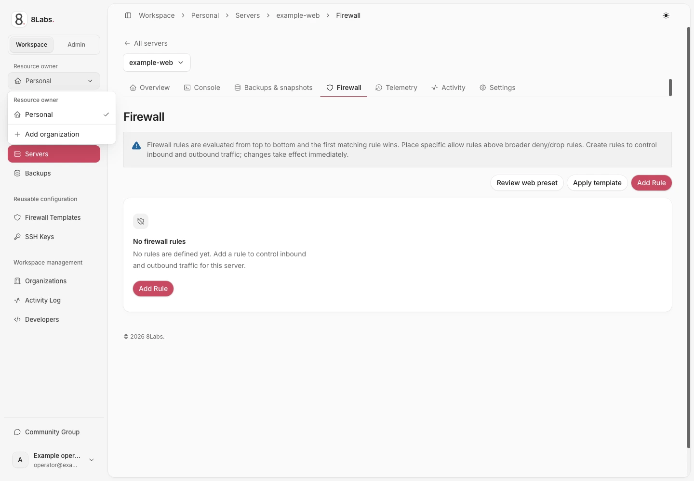
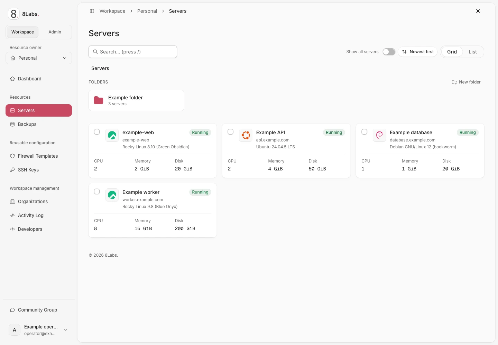
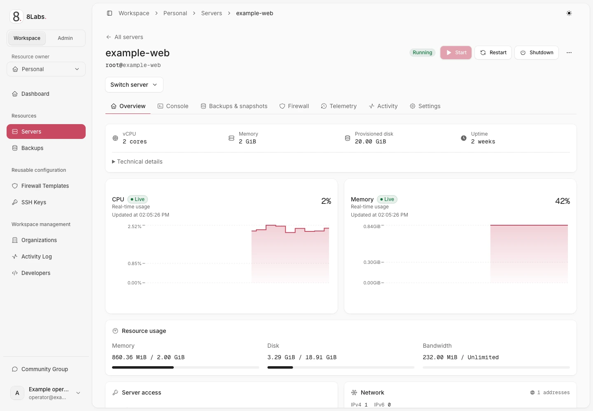

**Audience:** any authorized Cloud Panel user. The server inventory contains only resources your account can access.

_Workspace mode and resource ownership are separate controls._

## Select mode and ownership separately

**Workspace** mode is for customer tasks. **Admin** mode is for authorized platform operators and uses **Entire platform**.
The ownership switcher selects **Personal** or an organization within Workspace mode.
An organization admin is not a platform administrator. Changing context does not grant additional authority.

1. Open **Workspace** for customer tasks.
2. Select **Personal** or the intended organization.
3. Open **Servers**.
4. Search for the intended server or open its folder.
5. Select the server.

If the inventory is empty, check the workspace and delegated access before assuming the server was deleted.
Use [folders](/docs/servers/folders/) for organization and [projects](/docs/teams/projects/) for shared access.

_Server inventory and Workspace navigation._

## Use local server navigation

| Section                 | Task                                                                |
| ----------------------- | ------------------------------------------------------------------- |
| **Overview**            | Review state, installation progress, addresses, and power controls. |
| **Console**             | Open an authorized graphical or serial session.                     |
| **Backups & snapshots** | Review available recovery points and supported actions.             |
| **Firewall**            | Review rules before changing guest reachability.                    |
| **Telemetry**           | Inspect resource observations and time ranges.                      |
| **Activity**            | Review recorded actions and failures.                               |
| **Settings**            | Review configuration, access, reinstall, and deletion options.      |

Use the authorized resource switcher to change servers without confusing their local sections.
Use **All servers** to return to the inventory. Confirm the server name before any mutation.
Some sections and controls depend on permissions, host support, and service entitlement.

_Server overview, resource usage, and local navigation._

## Read state before acting

A request accepted by the Panel can remain queued or busy while the host processes it.
Wait for the current operation and its final state before submitting another action.
Stale or unknown observations do not prove that the machine is off.
See [telemetry and activity](/docs/servers/telemetry/) and [troubleshooting](/docs/troubleshooting/overview/).

Root administrators can use **View as customer** from the admin server page.
**Configure server** appears above the server sections in both ordinary server views and admin previews.
It retains a validated local admin return destination (`returnTo`), or opens that server's admin page by default.
These links do not change permissions. Customers should not expect access to the admin area.
