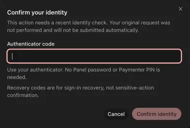

Kelola perlindungan akun runtime melalui **Account → Settings** di [cloud.8labs.id](https://cloud.8labs.id). Gunakan akun sendiri dan simpan materi pemulihan secara privat.

## Pengguna, ketersediaan, dan prasyarat

Tindakan ini memengaruhi akun runtime Anda sendiri. Tindakan tersebut tidak menetapkan atau mengubah kredensial portal penagihan my.8labs.id.

Sebelum mengaktifkan autentikasi dua faktor, siapkan aplikasi autentikator TOTP dan penyimpanan aman yang terpisah dari perangkat tersebut. Perubahan sensitif memakai metode konfirmasi identitas di bawah.

Konfigurasi layanan menentukan ketersediaan pemulihan kata sandi dan daftar sesi. Tidak adanya kontrol pemulihan bukan berarti pendaftaran publik atau undangan memiliki ketersediaan yang sama.

## Konfirmasikan identitas untuk perubahan sensitif

- **TOTP aktif:** masukkan kode autentikator enam digit yang masih berlaku. Kata sandi Panel dan PIN Paymenter tidak diperlukan. Kode pemulihan hanya untuk masuk, bukan konfirmasi ini.
- **Akun terhubung ke Paymenter tanpa TOTP:** gunakan PIN sesuai tujuan jika layanan yang cocok dan pembuat PIN portal penagihan tersedia.
- **Akun native tanpa hubungan Paymenter dan tanpa TOTP:** konfirmasikan kata sandi Panel saat ini. Ini bukan pengganti PIN akun terhubung yang tidak tersedia.

Sebelum penyiapan TOTP pertama, TOTP belum aktif. Karena itu, akun terhubung memerlukan persetujuan PIN dari layanan yang cocok dan tersedia sebelum melanjutkan penyiapan. Memiliki autentikator saja tidak menyetujui penyiapan pertama.

Konfirmasikan tindakan sensitif dengan kode autentikator, lalu kembali ke formulir dan simpan secara eksplisit.

Pembuat PIN Paymenter pada layanan saat ini belum tersedia. Hubungi [dukungan](/id/docs/help/contact) jika metode yang dipilih memerlukannya. Langkah di bawah menjelaskan alur yang didukung setelah layanan yang cocok dan pembuat PIN tersedia. Dukungan Panel saja tidak membuktikan ketersediaan pada portal penagihan. Jangan memakai pemulihan kata sandi atau email untuk melewati persetujuan yang diwajibkan.

1. Minta persetujuan melalui dialog identitas Panel untuk tindakan dan layanan yang dituju.
2. Buka layanan yang sama pada akun penagihan lalu buat PIN delapan digit, jika tersedia.
3. Masukkan PIN melalui sesi browser Panel semula sebelum batas waktu yang ditampilkan.
4. Kembali ke formulir semula, periksa isinya, lalu pilih **Save** atau tindakan yang dituju secara eksplisit.

Permintaan persetujuan awal berlaku sepuluh menit. Pembuatan ulang PIN mengganti PIN sebelumnya tanpa memperpanjang batas waktu itu. Bukti identitas terkonfirmasi berlaku paling lama lima menit. Bukti berbasis PIN juga berakhir pada batas waktu permintaan awal atau setelah satu perubahan terlindungi berhasil, mana yang lebih dahulu. Persetujuan tidak menyimpan formulir atau mengulang permintaan yang ditolak. Persetujuan kata sandi akun tidak mengizinkan pengelolaan API key atau tujuan sensitif lain.

## Ganti kata sandi

1. Buka **Account → Settings → Password**.
2. Selesaikan konfirmasi identitas untuk perubahan kata sandi akun dengan metode di atas.
3. Masukkan dan konfirmasikan kata sandi baru. Isi kata sandi saat ini hanya jika formulir akun native mewajibkannya.
4. Pilih **Save** secara eksplisit setelah persetujuan, lalu tunggu konfirmasi atau halaman masuk.
5. Masuk kembali dengan kata sandi baru.

Perubahan kata sandi mengeluarkan Anda dari sesi. Browser lain dengan sesi lama juga harus masuk kembali. Gunakan kata sandi unik yang memenuhi persyaratan pada layar.

### Pulihkan kata sandi yang terlupa

Pemulihan melalui email saat ini tidak tersedia pada halaman masuk layanan. Hubungi [dukungan](/id/docs/help/contact) untuk panduan pemulihan. Deployment lain dapat menyediakan **Forgot your password?** jika pemulihan diaktifkan.

1. Buka tautan tersebut dan masukkan email akun runtime Anda.
2. Kirim permintaan lalu periksa kotak masuk, termasuk folder spam.
3. Buka tautan pengaturan ulang dan buat kata sandi baru.
4. Masuk kembali dengan kata sandi baru.

Tautan pengaturan ulang yang didokumentasikan berlaku satu jam dan hanya sekali pakai. Pemulihan juga memerlukan pengiriman email yang berfungsi. Email tidak dijamin terkirim jika pemulihan dinonaktifkan atau layanan email tidak tersedia.

Jika tautan tidak ada, kedaluwarsa, atau email tidak diterima, hubungi [dukungan](/id/docs/help/contact). Jangan kirim kata sandi atau tautan pengaturan ulang. Mengatur ulang kata sandi tidak menggantikan faktor kedua yang hilang.

## Gunakan autentikasi dua faktor

Autentikasi dua faktor menambahkan kode TOTP enam digit setelah kata sandi saat masuk. Aplikasi yang sesuai antara lain Google Authenticator, 1Password, dan Aegis.

### Aktifkan autentikasi dua faktor

1. Buka **Account → Settings → Two-factor authentication → Turn on**.
2. Selesaikan konfirmasi identitas dengan metode di atas, lalu lanjutkan secara eksplisit untuk memulai penyiapan.
3. Pilih **Continue setup** setelah kartu kembali ke tampilan awal.
4. Konfirmasikan identitas lagi, lalu lanjutkan secara eksplisit untuk membuka kunci penyiapan.
5. Pindai kode QR dengan autentikator, atau masukkan kunci penyiapan yang ditampilkan secara manual.
6. Masukkan kode enam digit dari aplikasi lalu pilih **Confirm**.
7. Tunggu konfirmasi bahwa autentikasi dua faktor sudah aktif.
8. Pilih **Recovery codes** dan konfirmasikan identitas lagi dengan kode autentikator baru.
9. Lanjutkan secara eksplisit untuk melihat kode, lalu simpan dengan aman.

Faktor kedua baru aktif setelah kode valid dikonfirmasi. Menutup penyiapan yang belum selesai tidak mengaktifkannya. Perlakukan kode QR dan kunci penyiapan sebagai rahasia; jangan bagikan tangkapan layarnya.

### Simpan dan ganti kode pemulihan

Setiap kode pemulihan hanya dapat dipakai sekali untuk masuk dan akan habis setelah digunakan. Simpan terpisah dari perangkat autentikator.

Gunakan **Recovery codes** untuk melihat kumpulan kode setelah konfirmasi identitas. Gunakan **Regenerate codes** untuk mengganti seluruh kumpulan setelah konfirmasi. Saat TOTP aktif, gunakan kode autentikator, bukan kata sandi atau kode pemulihan. Segera perbarui salinan simpanan Anda. Jangan mengandalkan kode lama.

Melihat kode adalah pembacaan terlindungi. Pembuatan ulang adalah perubahan terlindungi yang membatalkan kumpulan lama. Selesaikan konfirmasi yang diminta, lalu ulangi tindakan melihat atau membuat ulang secara eksplisit. Pembacaan terlindungi tidak menghabiskan jatah satu perubahan terlindungi dari PIN.

Setelah membuat ulang kode, pilih **Recovery codes** dan konfirmasikan identitas lagi dengan kode autentikator baru sebelum melihat kumpulan pengganti. Pembuatan ulang membatalkan bukti identitas sebelumnya dan tidak otomatis menampilkan kode baru.

Jika autentikator dan seluruh kode pemulihan hilang, hubungi dukungan untuk pemulihan melalui operator. Pemulihan memerlukan pemeriksaan identitas; jangan menganggap akses akan langsung diberikan atau pemeriksaan bisa dilewati.

### Masuk dengan faktor kedua

Setelah memasukkan kata sandi, masukkan kode autentikator saat ini. Jika autentikator tidak tersedia, pilih **Lost your device? Use a recovery code** lalu masukkan kode simpanan yang belum digunakan.

Jika kode gagal, periksa waktu pada perangkat autentikator dan gunakan kode baru. Jangan membagikan atau mengirim kode pemulihan melalui saluran dukungan.

### Nonaktifkan autentikasi dua faktor

Pilih **Turn off** pada kartu yang sama lalu konfirmasikan identitas dengan kode autentikator saat ini. Konfirmasi sensitif juga melindungi penyiapan dan pengelolaan kode pemulihan. Kembali ke kartu lalu lanjutkan secara eksplisit setelah persetujuan.

Penonaktifan menghapus perlindungan masuk tersebut. Lakukan hanya jika diperlukan, lalu aktifkan kembali setelah berpindah perangkat autentikator.

## Tinjau sesi browser aktif

Jika didukung, **Active sessions** menampilkan browser yang masuk beserta alamat IP dan aktivitas terakhir. Anda dapat mencabut sesi lain, tetapi bukan sesi saat ini melalui daftar tersebut.

1. Buka **Account → Settings → Active sessions**.
2. Tinjau entri dan cabut sesi browser yang tidak dikenal.
3. Tunggu daftar diperbarui.
4. Ganti kata sandi jika akses mencurigakan.

Pencabutan satu atau semua sesi lain memerlukan konfirmasi identitas sensitif. Selesaikan metode yang dipilih, lalu ulangi pencabutan yang dituju secara eksplisit. Membaca daftar sesi tidak mencabut sesi apa pun.

Daftar dan pencabutan sesi memerlukan konfigurasi sesi panel berbasis database. Konfigurasi lain menampilkan pemberitahuan, bukan daftar. Pelanggan tidak perlu mengubah konfigurasi platform sendiri.

### Pahami permintaan masuk akibat sesi lama

Panel membandingkan hash kata sandi yang tersimpan dalam sesi dengan hash akun saat ini. Jika berbeda, browser diarahkan ke halaman masuk, bukan dibiarkan mengalami kesalahan 401.

Hal ini dapat terjadi setelah perubahan kata sandi di perangkat lain atau ketika browser sebelumnya masuk ke akun berbeda. Masuk kembali memperbarui sesi. Perlindungan ini tetap berlaku meskipun daftar sesi tidak tersedia.

Jika permintaan masuk yang tidak diharapkan terus terjadi, catat waktu dan kesalahannya lalu hubungi dukungan. Jangan kirim cookie sesi.

## Kelola kunci publik SSH

Buka **Workspace → SSH Keys** pada sidebar untuk mengelola daftar kunci publik tersimpan.

Penambahan dan penghapusan kunci SSH tersimpan juga memerlukan konfirmasi identitas sensitif. Setelah persetujuan, ulangi tindakan tambah atau hapus yang dituju secara eksplisit.

Kunci SSH akun menyimpan **kunci publik** yang dapat dipilih saat deployment, jika didukung, sebagai pengganti kata sandi root. Lihat [akses SSH](/id/docs/getting-started/ssh) dan [mengakses Virtual Labs](/id/docs/getting-started/accessing-virtual-labs).

Jangan pernah mengunggah kunci privat SSH. Jangan menganggap perubahan kunci publik tersimpan otomatis mengubah authorized keys pada server yang sudah dibuat.

### Tambahkan atau hapus kunci publik tersimpan

1. Temukan satu kunci publik OpenSSH pada perangkat Anda, biasanya dalam berkas `.pub`.
2. Buka **Workspace → SSH Keys → Add key**.
3. Isi **Name** dengan nama yang mudah dikenali, lalu tempel satu baris kunci pada **Public key**.
4. Kirim sekali dan tunggu pesan sukses serta pembaruan daftar.
5. Cocokkan sidik jari yang ditampilkan dengan kunci publik lokal sebelum memakainya.

Jalankan `ssh-keygen -lf ~/.ssh/id_ed25519.pub` pada komputer Anda jika lokasi kunci publik Anda memang sesuai.
Jika validasi gagal, periksa format kunci publik. Jangan menempelkan kunci privat atau beberapa kunci ke kolom satu kunci.

Untuk menghapus kunci tersimpan, pilih kontrol hapusnya, periksa **Remove SSH key**, lalu konfirmasikan entri yang dituju.
Tunggu sampai entri hilang dari daftar. Untuk mengganti kunci tersimpan, tambahkan pengganti sebelum menghapus entri lama.
Penghapusan tidak mencabut kunci yang sudah terpasang dalam tamu. Perbarui akun tamu terkait secara terpisah dengan sesi pemulihan yang berfungsi.
Jika kunci privat bocor, hapus otorisasi kunci tersebut dalam tamu lalu buat pengganti. Menghapus kunci publik tersimpan saja tidak cukup.

## Dugaan pengambilalihan akun

Cabut sesi browser yang tidak dikenal, ganti kata sandi, lalu tinjau [API keys](/id/docs/account/api-keys) dan [akses tim](/id/docs/teams/overview). Mencabut sesi browser tidak sama dengan mencabut API key.

Segera hubungi [dukungan 8Labs](/id/docs/help/contact) jika Anda tidak dapat mengambil kembali kendali. Sertakan identitas akun, waktu kejadian, dan pesan kesalahan yang sudah disamarkan. Jangan bagikan kata sandi, materi penyiapan TOTP, kode pemulihan, token, atau cookie.

## Panduan terkait

- [Personal API keys](/id/docs/account/api-keys)
- [Langganan notifikasi](/id/docs/account/notifications)
- [Undangan dan pendaftaran](/id/docs/teams/invitations)
