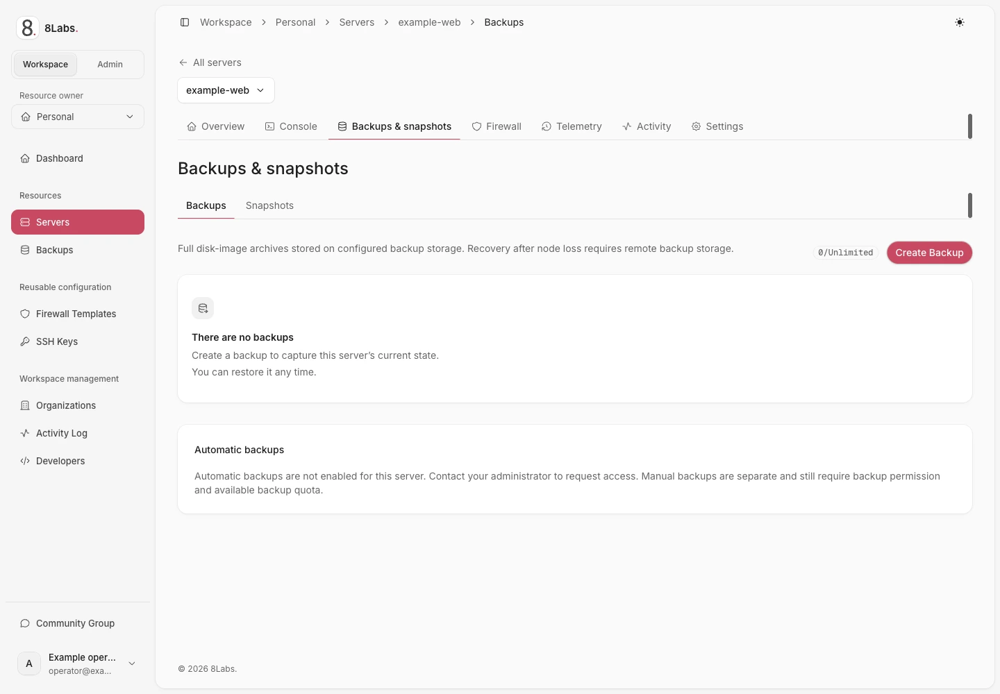

Backup merekam kondisi disk server melalui hypervisor. Gunakan backup yang sudah selesai sebagai titik pemulihan sebelum perubahan berisiko.

**Pemulihan menimpa kondisi disk server saat ini. Data yang ditulis setelah titik pemulihan akan hilang. Tindakan ini tidak dapat dibatalkan.** Pastikan server benar dan simpan data terbaru di tempat lain terlebih dahulu.

_Daftar cadangan dan ketersediaan cadangan otomatis._

## Pengguna, izin, dan prasyarat

Panduan ini untuk pemilik dan kolaborator berwenang di [cloud.8labs.id](https://cloud.8labs.id). Penyimpanan, ekspor, kuota, dan penjadwalan bergantung pada layanan serta hak server.

- `backup.read` mengizinkan melihat backup dan meminta ekspor jika tersedia.
- `backup.write` mengizinkan pembuatan, penghapusan, dan perubahan jadwal.
- `backup.restore` mengizinkan pemulihan. Shutdown dan startup memerlukan izin daya terpisah.

Periksa kuota dan server tujuan. Koordinasikan konsistensi data aplikasi dengan administrator aplikasi Anda. Jangan menganggap backup disk mencakup database jarak jauh atau volume eksternal.

Lokasi dan ketahanan penyimpanan ditentukan operator. Backup tidak otomatis menjadi salinan di lokasi lain. Tanyakan cakupan penyimpanan dan pemulihan layanan kepada dukungan.

## Membuat backup manual

1. Buka server lalu pilih **Backups → Create Backup**.
2. Masukkan nama yang mudah dikenali, maksimal 40 karakter.
3. Tinjau **Compression Type** dan **Mode**.
4. Pilih **Create** sekali lalu tunggu tugas latar belakang.
5. Pastikan backup selesai dengan sukses sebelum mengandalkannya untuk pemulihan.

Form menyediakan kompresi **None**, **LZO**, **GZip**, dan **ZSTD**. **Snapshot** adalah mode backup, bukan snapshot rantai disk di halaman **Snapshots**. **Suspend** dan **Kill** dapat mengganggu beban kerja; **Kill** meminta backup dengan server dihentikan. Gunakan waktu pemeliharaan jika gangguan tidak dapat diterima.

Permintaan diterima atau baris pending belum berarti backup selesai. Tugas hypervisor harus sukses dan arsip tepatnya harus ditemukan di penyimpanan backup. Visibilitas arsip dapat terlambat setelah tugas selesai.

### Kuota dan batas permintaan

| Batas                     | Artinya                                                                                                                                      |
| ------------------------- | -------------------------------------------------------------------------------------------------------------------------------------------- |
| Batas backup nol          | Pembuatan dinonaktifkan. Tanyakan hak yang tersedia kepada dukungan.                                                                         |
| Batas backup tertentu     | Hapus backup yang memenuhi syarat dan tidak diperlukan, atau minta perubahan batas. Jangan hapus satu-satunya titik pemulihan terverifikasi. |
| Jumlah tidak dibatasi     | Tidak ada batas jumlah yang dikonfigurasi; kapasitas penyimpanan dan batas lain tetap berlaku. Ini tidak mengaktifkan backup otomatis.       |
| Penggunaan tidak tersedia | Panel tidak menganggap penggunaan nol. Selesaikan kesalahan pemuatan sebelum membuat backup.                                                 |
| Batas laju permintaan     | Pengaman membatasi permintaan berulang. Nilai bawaan sumber adalah dua permintaan per sepuluh menit; pengaturan layanan dapat berbeda.       |

Arsip yang sudah ada tetap terlihat saat kuota atau hak backup otomatis berubah. Implementasi yang ditinjau tidak mengenakan biaya proses terjadwal untuk pembuatan manual; periksa ketentuan layanan untuk biaya yang berlaku.

## Memulihkan backup yang selesai

**Jangan lanjutkan jika kehilangan data terbaru tidak dapat diterima.** Pemulihan menargetkan server ini, bukan server pratinjau terpisah.

1. Cocokkan identitas server, nama backup, waktu pembuatan, dan status sukses.
2. Salin data terbaru yang masih diperlukan ke lokasi aman terpisah.
3. Lakukan shutdown dan tunggu server berstatus **Stopped** serta tidak sedang menjalankan operasi lain.
4. Buka menu **⋯** backup lalu pilih **Restore**.
5. Baca konfirmasi dan setujui hanya titik pemulihan yang dimaksud.
6. Tunggu pemulihan selesai dan status proses menghilang.
7. Periksa status daya sebelum menyalakan server, lalu tinjau aplikasi dan data melalui konsol.

Hanya backup sukses yang selesai, milik server ini, dan memiliki nama berkas arsip tercatat yang memenuhi syarat. Jangan memaksakan catatan gagal, belum selesai, salah server, atau tanpa arsip.

Permintaan restore yang diterima berarti proses dimulai, bukan pemulihan berhasil. Jika gagal atau terus berjalan, hindari tindakan destruktif lain dan hubungi dukungan.

## Mengunduh ekspor yang tersedia

Jika ekspor dikonfigurasi, **⋯ → Download** pada backup sukses meminta tautan sementara penyimpanan objek. Transfer berlangsung langsung dari penyimpanan, bukan melalui panel.

Gunakan tautan segera. Masa berlaku bawaan yang ditinjau sekitar satu jam; konfigurasi layanan dapat berbeda. Perlakukan URL sebagai rahasia karena dapat memberikan akses ke arsip.

Jika tautan kedaluwarsa, minta tautan baru melalui panel. Tidak adanya **Download** dapat berarti ekspor belum tersedia. Backup yang terlihat tidak selalu dapat diunduh.

Simpan arsip unduhan dalam penyimpanan dengan pembatasan akses. Pastikan transfer selesai sebelum mengandalkannya. Tanyakan prosedur pemulihan yang didukung untuk arsip ekspor kepada dukungan.

## Mengatur backup otomatis

Backup otomatis memerlukan pengaktifan administrator secara eksplisit **untuk setiap server**. Kuota tanpa batas atau akses daftar backup seluruh akun tidak memberikan hak penjadwalan.

1. Buka halaman **Backups** server lalu cari **Automatic backups**.
2. Pastikan hak fitur, kuota, dan harga per proses yang ditampilkan.
3. Aktifkan **Run automatic backups**.
4. Pilih frekuensi harian, mingguan, atau bulanan.
5. Atur **Hour (UTC)** serta hari mingguan atau tanggal bulanan yang sesuai.
6. Pilih jumlah backup terjadwal yang disimpan lalu pilih **Save**.
7. Periksa jadwal berikutnya, lalu tinjau backup yang dihasilkan setelah waktu tersebut.

Tanggal bulanan dibatasi 1–28. Retensi tidak boleh melebihi batas backup tertentu, atau 50 jika jumlah tidak dibatasi. Batas nol tetap menonaktifkan pembuatan backup.

Proses berjalan dengan ketelitian per jam. Jadwal 03:00 diproses pada putaran penjadwal pertama pada atau setelah jam tersebut, bukan pada menit yang dijamin tepat.

### Retensi dan keamanan arsip

Titik pemulihan lama hanya dihapus setelah penggantinya sukses dan arsip tepatnya terverifikasi di penyimpanan. Kegagalan pengiriman, penyimpanan penuh, tugas gagal, atau monitor timeout tidak mengizinkan penghapusan lebih awal.

Backup manual, terkunci, dan belum selesai tidak dipilih untuk retensi otomatis. Saat kuota penuh, satu backup pengganti terjadwal dapat memakai satu slot tambahan sementara jika ada backup terjadwal sukses yang tidak terkunci untuk diganti dan tidak ada backup pending.

Penyimpanan harus mampu menampung kedua arsip. Panel tidak menghapus arsip lama terlebih dahulu untuk menyediakan ruang. Permintaan manual tetap mengikuti kuota dan batas laju normal.

Setiap proses menyimpan target retensi dan daftar catatan tertua yang memenuhi syarat sebelum dimulai. Perubahan atau penghapusan jadwal berikutnya tidak memperluas daftar penghapusan itu. Pengganti tidak menjadi sasaran pembersihan.

Backup terlindungi dapat membuat jumlah tetap di atas target. Jika catatan lama dan baru merujuk arsip sama, retensi mempertahankannya agar pengganti tidak terhapus. Minta dukungan menyelaraskan catatan duplikat.

Kegagalan pembersihan tidak mengubah backup terverifikasi menjadi gagal. Monitor mencoba ulang pembersihan; dukungan dapat melanjutkan job yang kehabisan percobaan menggunakan daftar penghapusan yang sama. Jangan menghapus arsip secara manual untuk memperbaiki jumlah.

Jika hak fitur dicabut, proses berikutnya dilewati tanpa backup baru, biaya dompet, atau penghapusan arsip. Jadwal tersimpan dan titik pemulihan lama tetap ada. Anda dapat menonaktifkan jadwal; pengaktifan kembali memerlukan hak fitur. Proses yang sudah diterima dapat selesai dengan kebijakan retensi yang telah disimpan.

### Memahami biaya opsional backup terjadwal

Jika diaktifkan pada layanan, kartu jadwal menampilkan biaya per proses sebelum pengaktifan. Dompet pembayar server dikenai biaya saat pengiriman tugas, bukan setelah verifikasi arsip.

Jika saldo tidak cukup, proses dilewati: tidak ada backup dan tidak ada biaya. Tambahkan saldo pembayar yang benar melalui proses penagihan yang didukung, lalu periksa jadwal berikutnya.

Proses yang gagal setelah dikirim **tidak** memicu pengembalian dana otomatis. Hubungi dukungan untuk peninjauan. Gunakan [my.8labs.id](https://my.8labs.id) untuk penagihan pelanggan; jangan menganggap saldo atau akses masuknya sama dengan dompet panel runtime.

## Pemecahan masalah

| Gejala                                    | Langkah aman berikutnya                                                                                                                                                                    |
| ----------------------------------------- | ------------------------------------------------------------------------------------------------------------------------------------------------------------------------------------------ |
| “Too many backups”                        | Periksa jumlah dan kuota. Hapus hanya backup tak diperlukan yang memenuhi syarat, atau minta kenaikan batas.                                                                               |
| Pembuatan nonaktif saat penggunaan dimuat | Tunggu atau muat ulang sekali. Permintaan penggunaan yang gagal bukan penggunaan nol.                                                                                                      |
| Backup belum selesai selama berjam-jam    | Catat ID dan waktu mulai. Minta dukungan memeriksa tugas dan visibilitas arsip sebelum mengirim ulang. Penanganan catatan macet memiliki nilai bawaan enam jam, bukan janji waktu selesai. |
| Tugas sukses tetapi baris masih pending   | Verifikasi arsip tepatnya mungkin belum selesai. Pertahankan titik pemulihan sebelumnya; hubungi dukungan jika berlanjut.                                                                  |
| Backup gagal                              | Pertahankan backup terverifikasi terakhir. Catat kesalahan dan waktu; tanyakan kondisi penyimpanan atau hypervisor kepada dukungan.                                                        |
| Tidak ada **Download**                    | Periksa status selesai dan akses. Ekspor mungkin belum dikonfigurasi untuk layanan.                                                                                                        |
| Tautan unduhan kedaluwarsa                | Minta tautan baru. Jangan publikasikan URL lama.                                                                                                                                           |
| Restore ditolak                           | Periksa kecocokan server, keberhasilan backup, catatan arsip, status stopped, tidak adanya operasi lain, dan izin.                                                                         |
| Backup terjadwal berhenti                 | Periksa hak per server, kuota nol/penuh, job pending, waktu UTC, dan saldo pembayar jika biaya berlaku.                                                                                    |
| Jumlah retensi tetap tinggi               | Catatan terlindungi, duplikat, atau percobaan pembersihan dapat menghalangi target. Hubungi dukungan; jangan menghapus objek penyimpanan sendiri.                                          |

Kirim identitas server dan backup, waktu UTC, status, serta pesan kesalahan ke [dukungan 8Labs](/id/docs/help/contact). Jangan kirim tautan arsip, kata sandi, kunci privat, atau isi sensitif yang belum disensor.

## Panduan terkait

- [Snapshot bukan backup eksternal](/id/docs/servers/snapshots)
- [Tindakan daya server](/id/docs/servers/power)
- [Pengaturan dan tindakan destruktif](/id/docs/servers/settings)
- [Penagihan dan paket](/id/docs/billing-plans/overview)
- [Pemecahan masalah](/id/docs/troubleshooting/overview)
