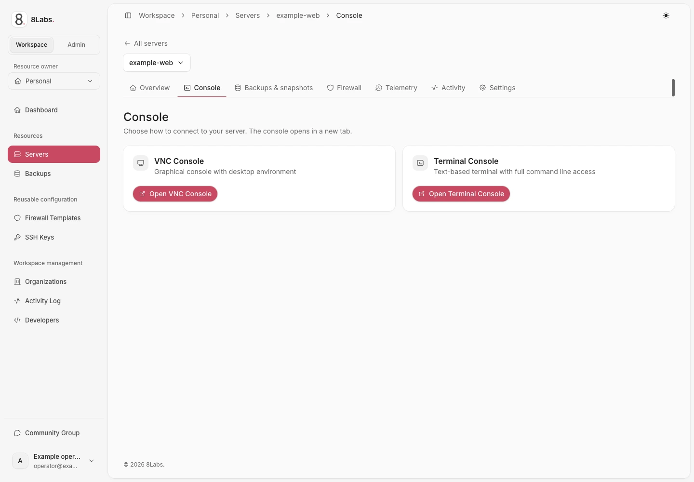

**Pembaca:** pengguna server dengan `control.console` atau izin efektif yang mencakup akses konsol.
**Ketersediaan:** operator harus menyiapkan broker konsol dan server harus mendukung jenis konsol yang dipilih.

## Sebelum membuka konsol

Konsol peramban menghubungkan mesin virtual melalui host-nya. Konsol bukan SSH dan tidak memerlukan jaringan SSH tamu.
Host, layanan konsol, dan sesi Panel tetap harus berfungsi.
Gunakan akun sistem operasi tamu untuk masuk, bukan kata sandi Cloud Panel.
Image Linux yang disiapkan dengan kunci saja mungkin tidak memiliki kata sandi.
Jangan mengaktifkan masuk root dengan kata sandi hanya untuk memperoleh prompt konsol.

## Buka sesi

1. Buka [Cloud Panel](https://cloud.8labs.id).
2. Buka **Servers**, lalu pilih server yang benar.
3. Buka **Console**.
4. Pilih **VNC** grafis atau **Serial** jika pilihan tersebut tersedia.
5. Jika jendela diblokir, izinkan jendela konsol hanya untuk situs Panel tepercaya.
6. Tunggu status koneksi sebelum memasukkan input tamu.
7. Masuk ke tamu jika prompt autentikasi muncul.

Panel memberikan kredensial peluncuran berumur pendek kepada layanan konsol yang dikonfigurasi.
Peluncur menghapus kredensial dari alamat sebelum menyiapkan sesi. Jangan menyalin atau membagikan URL peluncuran.
Sesi yang sudah terhubung dapat berlanjut setelah masa peluncuran berakhir.
Koneksi baru setelah kedaluwarsa memerlukan peluncuran baru dari Panel.
Simpan halaman server sebagai bookmark, bukan alamat peluncuran konsol.

_Pilih konsol VNC grafis atau konsol terminal._

## Pilih jenis konsol

**VNC** menampilkan layar grafis tamu. Isinya dapat berupa firmware, desktop grafis, atau layar masuk teks.
**Serial** menampilkan terminal serial yang dikonfigurasi pada tamu.
Layar serial kosong dapat berarti tamu tidak menyediakan prompt serial.
Kedua pilihan tidak menjamin tamu berjalan atau kredensialnya telah disiapkan.
Periksa status koneksi untuk membedakan koneksi terputus dari layar tamu yang kosong.

## Keyboard, clipboard, dan tampilan

Petunjuk ini menjelaskan kontrol EdgeTerm 1.0.4. Broker Panel langsung dapat menampilkan kontrol yang berbeda.
Klik area tampilan sebelum mengetik. Peramban atau sistem operasi dapat menangkap pintasan sebelum mencapai tamu.

### Gunakan kontrol samping

- Pilih **Keyboard** untuk memfokuskan input tamu dan membuka keyboard perangkat.
- Buka **Keyboard shortcuts** untuk Esc, Tab, panah, Backspace, Enter, dan kombinasi khusus tamu.
- Ctrl, Alt, dan Shift berlaku untuk satu kombinasi. Pilihan dihapus saat kontrol ditutup, fokus berubah, atau koneksi berakhir.
- Konfirmasikan Ctrl+D serial atau Ctrl+Alt+Del grafis hanya jika Anda menginginkan dampaknya pada tamu.
- Gunakan **Move controls to left/right** untuk memindahkan kontrol. Tombol panah menciutkannya menjadi satu tombol pemulih.
- Arahkan penunjuk atau fokuskan ikon untuk membaca petunjuk. Petunjuk tidak mengirim input tamu.

Gunakan kontrol skala atau penyesuaian VNC jika tersedia. Kontrol itu tidak mengubah resolusi tamu atau sumber daya server.
Keyboard ponsel, izin clipboard, rotasi, dan layar penuh bergantung pada peramban serta perangkat.

### Periksa teks sebelum mengirim

1. Pilih **Paste text**, atau tempel saat konsol memiliki fokus.
2. Periksa teks yang dapat diedit, jumlah karakter, dan jumlah baris.
3. Periksa tujuan serta setiap baris baru. Baris baru dapat menjalankan perintah.
4. Pilih tindakan yang sesuai di bawah, atau batalkan tanpa mengirim.

Tempel bawaan membuka **Review text before sending**, termasuk untuk satu baris teks.
Ctrl+Shift+V atau ⌘V membuka pemeriksaan pada kedua mode. Ctrl+V grafis juga membuka pemeriksaan.
Ctrl+V serial mempertahankan input literal. Gunakan **Paste text** jika peramban menangkap pintasan.
**Read clipboard** meminta izin peramban. Jika izin atau dukungan tidak tersedia, tempel secara manual ke kolom pemeriksaan.
Menutup pemeriksaan, membatalkan, atau memutus koneksi menghapus teks sementara.

| Tindakan                           | Hasil                                                                                                            |
| ---------------------------------- | ---------------------------------------------------------------------------------------------------------------- |
| **Send text** serial               | Mengirim teks melalui penanganan tempel terminal. Dukungan bracketed paste tamu dapat memengaruhi penafsirannya. |
| **Type text** grafis               | Mengirim tombol karakter tanpa clipboard tamu. Baris baru mengirim Return dan tab mengirim Tab.                  |
| **Copy to guest clipboard** grafis | Hanya menyinkronkan teks. Tindakan ini tidak mengetik teks atau mengirim pintasan tempel ke tamu.                |

Dukungan keyboard dan Unicode tamu berbeda-beda. Encoding clipboard dapat mengganti karakter yang tidak didukung dengan `?`.
Sinkronisasi clipboard tidak menjamin teks mencapai aplikasi. Tidak ada tindakan gabungan salin dan Ctrl+V.
Jangan menempelkan rahasia atau perintah sebelum memeriksa tujuan fokus.

## Sesi kedaluwarsa atau terputus

| Status                                | Tindakan berikutnya                                                                                                    |
| ------------------------------------- | ---------------------------------------------------------------------------------------------------------------------- |
| Peluncuran tidak ada atau tidak valid | Tutup konsol dan buka kembali dari halaman server yang diizinkan.                                                      |
| Peluncuran kedaluwarsa                | Kembali ke Panel dan minta sesi konsol baru.                                                                           |
| Koneksi terputus                      | Kembali ke halaman server yang diizinkan dan luncurkan konsol baru. EdgeTerm tidak menyambung kembali secara otomatis. |
| Tampilan serial kosong                | Pastikan image mendukung serial. Gunakan VNC jika didukung.                                                            |
| Akses Panel ditolak                   | Minta pemilik memeriksa izin konsol efektif Anda.                                                                      |
| Host atau broker tidak tersedia       | Hubungi dukungan; perubahan SSH tamu tidak memperbaiki broker.                                                         |

Sebagian penerapan dapat memakai jalur broker Panel langsung. Kontrol dan pemulihannya dapat berbeda dari EdgeTerm.
Ikuti petunjuk penerapan tersebut. Jangan mengubah URL konsol sendiri.
Menutup konsol memutus tampilan peramban itu, bukan mematikan server atau mengakhiri semua sesi tamu.

## Laporkan masalah dengan aman

Kirim waktu, versi peramban, jenis konsol, status koneksi, dan pesan kesalahan yang disamarkan kepada [dukungan](/id/docs/help/contact/).
Jangan kirim URL peluncuran, cookie, ekspor penyimpanan peramban, tiket konsol, JWT, atau rekaman jaringan mentah.
Hilangkan isi terminal dan identitas sebelum membagikan tangkapan layar.

[Koneksi SSH](/id/docs/getting-started/ssh/) · [Kontrol daya](/id/docs/servers/power/) · [Pemulihan](/id/docs/troubleshooting/overview/)
