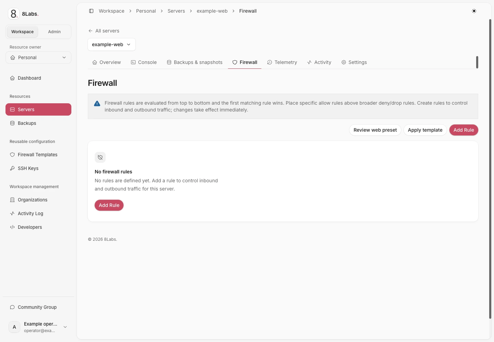

**Perubahan firewall langsung berlaku dan dapat memutus koneksi. Pastikan konsol berfungsi sebelum mengedit, menerapkan templat, atau memakai preset.** Sesi SSH atau RDP yang sudah terbuka bukan konsol pemulihan.

_Aturan firewall dan panduan urutan aturan._

## Pengguna, izin, dan prasyarat

Panduan ini untuk pemilik dan kolaborator yang berwenang mengelola server di [cloud.8labs.id](https://cloud.8labs.id). Perubahan memerlukan `firewall.manage`; kontrol layanan dapat berbeda.

Sebelum melanjutkan:

- Buka dan uji [konsol server](/id/docs/servers/console).
- Catat aturan lama. Jika tidak diketahui, pastikan kebijakan bawaan masuk dan keluar kepada dukungan.
- Pastikan protokol pengelolaan, port sebenarnya di sistem tamu, dan alamat sumber tepercaya.
- Periksa firewall tamu serta konfigurasi layanan secara terpisah.
- Pastikan tidak ada orang lain mengedit daftar aturan selama perubahan Anda.

Penambahan aturan mencoba mengaktifkan firewall VM **sebelum** aturan dibuat. Deny lama atau kebijakan bawaan dapat memutus koneksi sebelum allow baru terpasang. Keberhasilan pembuatan aturan saja belum membuktikan penegakan efektif; periksa perilakunya.

## Memahami urutan dan kebijakan bawaan

Aturan dievaluasi dari atas ke bawah. Aturan pertama yang cocok menentukan hasilnya. Tempatkan allow khusus sebelum deny atau drop yang lebih luas.

| Kolom atau nilai     | Arti                                                                        |
| -------------------- | --------------------------------------------------------------------------- |
| **Direction: IN**    | Trafik menuju server.                                                       |
| **Direction: OUT**   | Trafik dari server.                                                         |
| **ACCEPT**           | Mengizinkan trafik yang cocok.                                              |
| **DROP**             | Membuang trafik tanpa balasan.                                              |
| **REJECT**           | Menolak trafik secara aktif.                                                |
| **Enabled** nonaktif | Menyimpan aturan tanpa menerapkannya. Aturan baru aktif secara bawaan.      |
| **Macro**            | Pilihan protokol/port siap pakai. Pastikan cocok dengan layanan sebenarnya. |

Trafik yang tidak cocok dengan aturan dipengaruhi kebijakan bawaan dan infrastruktur lain. Daftar kosong bukan bukti akses tanpa pembatasan. Editor pelanggan yang ditinjau tidak menyediakan pengubah kebijakan bawaan; minta dukungan meninjaunya.

Perubahan IP utama tidak mengatur ulang aturan atau kebijakan bawaan firewall. Kebijakan ketat tetap berlaku setelah sinkronisasi jaringan.

## Menambah atau mengedit aturan individual

1. Buka **Firewall** server dan tunggu daftar aturan termuat.
2. Tinjau urutan yang ada dan biarkan konsol terbuka.
3. Pilih **Add Rule**, atau edit aturan yang dimaksud.
4. Atur **Direction**, **Action**, dan **Enabled** dengan sengaja.
5. Pilih **Macro**, atau isi **Protocol** sebenarnya beserta kolom port yang sesuai.
6. Batasi **Source (IP, range, list)** dan tujuan jika diperlukan.
7. Isi **Comment** untuk menjelaskan tujuan aturan.
8. Simpan sekali lalu tunggu daftar diperbarui.
9. Periksa posisi dan status aktif, lalu uji koneksi pengelolaan baru sebelum menutup sesi lama.

Untuk allow pengelolaan TCP khusus, gunakan port layanan di sistem tamu sebagai **Destination Port(s)**. Port sumber sementara milik klien biasanya bukan port layanan tersebut. Protokol khusus memerlukan kolom port yang sesuai; ICMP menggunakan **ICMP Type**.

Kolom alamat menerima IP, CIDR, rentang, atau daftar. Kolom port mendukung satu port, rentang, atau nilai dipisahkan koma. Gunakan alamat terverifikasi; `192.0.2.10/32` adalah contoh dokumentasi, bukan IP klien Anda.

Gunakan **Move up**, **Move down**, **Move First**, atau **Move Last** untuk mengubah urutan. Baca ulang rangkaian aturan terkait setelah setiap pemindahan. Pengaktifan, penonaktifan, pengeditan, dan penghapusan adalah perubahan terpisah, bukan satu transaksi.

Allow tidak membuat pemetaan NAT, menjalankan layanan tamu, atau melewati semua firewall jaringan lain. Baca [akses jaringan](/id/docs/servers/network).

## Menerapkan templat yang dapat digunakan ulang

**Apply template** menambahkan aturan dari templat terpilih. Aturan server yang sudah ada tetap dipertahankan; ini bukan pengganti seluruh kebijakan atau titik rollback.

1. Tinjau protokol, sumber, dan aturan deny pada templat.
2. Pastikan konsol pemulihan berfungsi dan tidak ada pengeditan bersamaan.
3. Pilih **Apply template**, pilih templat tujuan, lalu terapkan sekali.
4. Tunggu hasilnya, termasuk laporan kegagalan.
5. Tinjau seluruh aturan hasil, posisi, dan status aktifnya.
6. Uji trafik pengelolaan dan aplikasi yang diperlukan.

Penerapan templat **tidak atomik**. Aturan dikirim satu per satu; sebagian dapat sukses sementara lainnya gagal. Aturan yang berhasil dibuat tetap ada. Jangan langsung menerapkan ulang karena dapat menggandakan aturan. Cocokkan daftar sebenarnya, lalu perbaiki kegagalan individual atau hubungi dukungan.

## Meninjau preset web

**Review web preset** membuka dialog tinjauan; membukanya tidak mengubah aturan.

Preset menambahkan:

- SSH melalui TCP pada port pilihan Anda, **atau** RDP melalui TCP dan UDP pada port pilihan Anda.
- HTTP melalui TCP port 80 dan HTTPS melalui TCP port 443.
- Aturan `DROP` masuk di posisi terakhir.

Pengamatan OS terbaru dari guest agent dapat menyarankan SSH untuk Linux/Unix atau RDP untuk Windows. Metadata dari templat saja, sudah lama, atau tidak diketahui tidak memilih protokol. Port bawaan 22 dan 3389 hanya panduan, bukan deteksi port Anda.

**Allow pengelolaan, HTTP, dan HTTPS baru menerima semua sumber.** Aturan dipindahkan mendahului aturan lama dan dapat melewati deny atau pembatasan sumber pada port tersebut. Batalkan dan gunakan aturan individual jika akses pengelolaan harus dibatasi.

### Menerapkan setelah memahami risikonya

1. Biarkan konsol yang berfungsi terbuka dan hentikan pengeditan aturan bersamaan.
2. Pilih protokol pengelolaan terverifikasi serta port sebenarnya di sistem tamu.
3. Tinjau allow dari semua sumber dan kebijakan masuk yang dihasilkan.
4. Berikan persetujuan dialog hanya jika kebijakan tersebut memang diinginkan.
5. Pilih **Apply preset now** sekali lalu tunggu hasil lengkap.
6. Periksa urutan, status aktif, dan pesan kegagalan sebagian.
7. Uji koneksi pengelolaan baru serta trafik web yang diperlukan.

Preset menempatkan `DROP` masuk terakhir dalam keadaan nonaktif. Allow baru diverifikasi sebelum drop diaktifkan. Urutan relatif aturan lama lainnya dipertahankan.

**Proses ini tidak atomik dan tidak memiliki rollback otomatis.** Aktivasi firewall VM mendahului allow pertama. Kegagalan sebagian meninggalkan aturan yang berhasil dibuat. Verifikasi akhir tidak dapat mencegah perubahan oleh editor lain setelahnya.

Jika penerapan gagal, muat ulang dan periksa daftar sebenarnya sebelum mencoba lagi. Drop yang masih nonaktif dapat tertinggal. Jangan menganggap tidak ada perubahan atau seluruh kebijakan sudah lengkap.

## Pemecahan masalah dan eskalasi

| Gejala                                  | Langkah aman berikutnya                                                                                                                |
| --------------------------------------- | -------------------------------------------------------------------------------------------------------------------------------------- |
| SSH atau RDP terputus                   | Gunakan konsol teruji. Periksa urutan, port tamu sebenarnya, pembatasan sumber, dan kebijakan bawaan. Jangan asal menambah allow luas. |
| Aturan ada tetapi trafik gagal          | Periksa **Enabled**, aturan lebih awal yang cocok, arah, listener tamu, firewall tamu, filter jaringan lain, dan NAT.                  |
| Daftar gagal dimuat                     | Tunggu lalu gunakan **Retry**. Jangan mengedit berdasarkan daftar tidak lengkap atau lama.                                             |
| Izin ditolak                            | Minta `firewall.manage` kepada pemilik. `settings.manage` tidak cukup.                                                                 |
| Templat atau preset diterapkan sebagian | Simpan kesalahan dan periksa daftar. Perbaiki hanya perbedaan yang dipahami; penerapan ulang dapat menggandakan allow atau deny.       |
| Akses pengelolaan terbuka terlalu luas  | Periksa aturan preset sebelum aturan pembatasan sumber. Gunakan perubahan individual dengan konsol untuk mengembalikan pembatasan.     |
| Konsol tidak berfungsi                  | Hentikan perubahan firewall dan hubungi dukungan sebelum mempertaruhkan akses pengelolaan.                                             |

Hubungi [dukungan 8Labs](/id/docs/help/contact) untuk kebijakan bawaan yang tidak diketahui, kegagalan API berulang, atau akses hilang. Sertakan ID server, waktu UTC, protokol/port tujuan, dan urutan aturan yang disensor. Jangan sertakan kredensial atau token sesi.

## Panduan terkait

- [Akses konsol](/id/docs/servers/console)
- [Alamat jaringan dan NAT](/id/docs/servers/network)
- [Akses SSH](/id/docs/getting-started/ssh)
- [Akses RDP](/id/docs/getting-started/rdp)
- [Pemecahan masalah](/id/docs/troubleshooting/overview)
