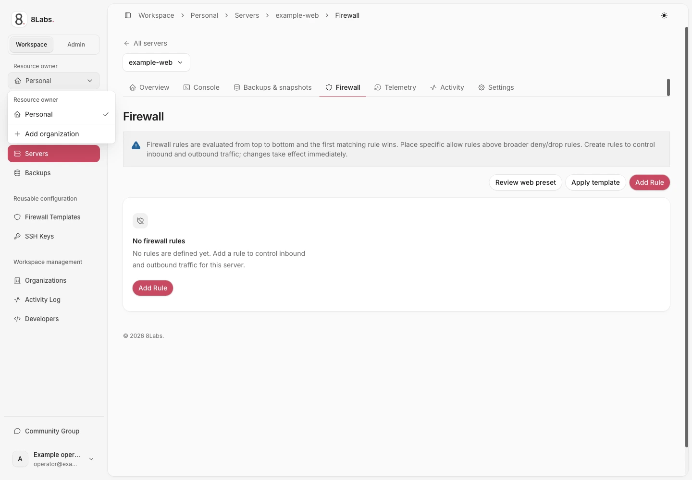
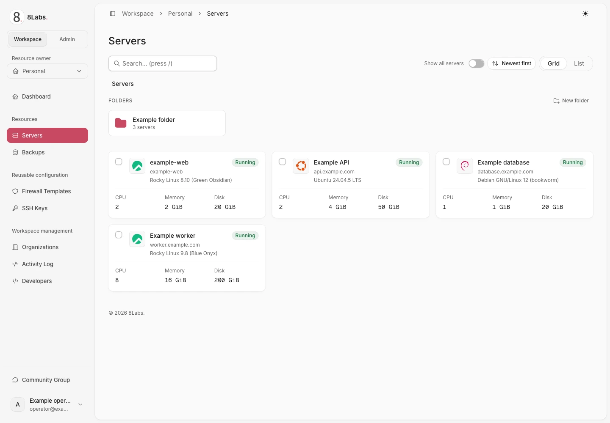
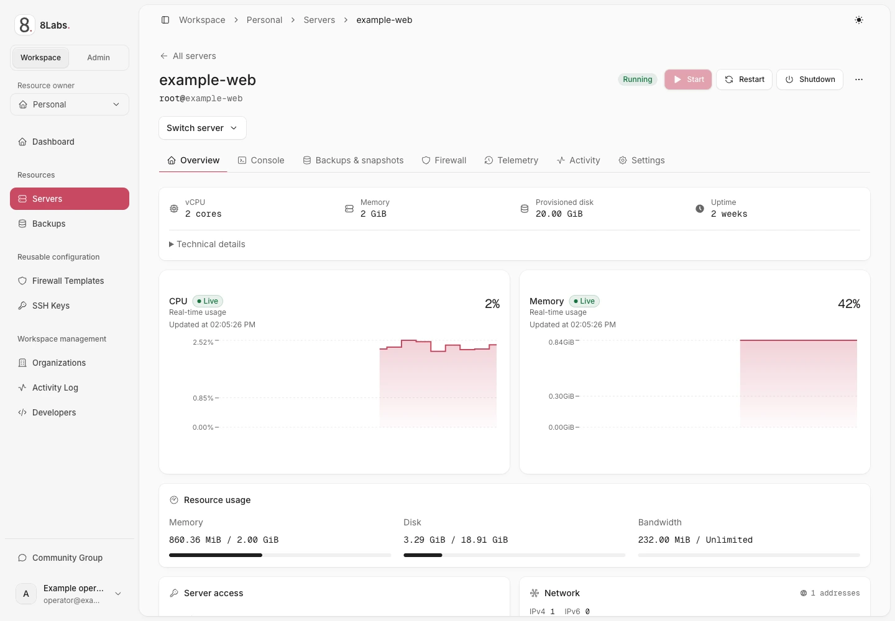

**Pembaca:** semua pengguna Cloud Panel yang diberi izin. Inventaris hanya menampilkan sumber daya yang dapat diakses akun Anda.

_UI produksi yang disanitasi — pengamatan hanya-baca — LabsPanel v5.3.15. Mode Workspace/Admin dan Resource owner adalah kontrol yang terpisah. Menu pemilik yang terbuka menampilkan opsi Personal dan tindakan Add organization yang teramati. Label UI tetap berbahasa Inggris; hanya keterangan gambar yang diterjemahkan._

## Pilih mode dan kepemilikan secara terpisah

Mode **Workspace** digunakan untuk tugas pelanggan.
Mode **Admin** hanya untuk operator platform yang berwenang dan memakai **Entire platform**.
Pemilih kepemilikan memilih **Personal** atau organisasi dalam mode Workspace.
Admin organisasi bukan administrator platform. Pergantian konteks tidak menambah kewenangan.

1. Buka **Workspace** untuk tugas pelanggan.
2. Pilih **Personal** atau organisasi yang dituju.
3. Buka **Servers**.
4. Cari server atau buka foldernya.
5. Pilih server.

Jika inventaris kosong, periksa ruang kerja dan akses delegasi sebelum menganggap server telah dihapus.
Gunakan [folder](/id/docs/servers/folders/) untuk pengelompokan dan [proyek](/id/docs/teams/projects/) untuk berbagi akses.

_UI produksi yang disanitasi — pengamatan hanya-baca — LabsPanel v5.3.15. Inventaris server Workspace dengan nama contoh; pemilik resource tetap Personal. Label UI tetap berbahasa Inggris; hanya keterangan gambar yang diterjemahkan._

## Gunakan navigasi lokal server

| Bagian                  | Tugas                                                              |
| ----------------------- | ------------------------------------------------------------------ |
| **Overview**            | Periksa status, kemajuan instalasi, alamat, dan kontrol daya.      |
| **Console**             | Buka sesi grafis atau serial yang diizinkan.                       |
| **Backups & snapshots** | Periksa titik pemulihan serta tindakan yang didukung.              |
| **Firewall**            | Periksa aturan sebelum mengubah jangkauan jaringan tamu.           |
| **Telemetry**           | Periksa pengamatan sumber daya dan rentang waktu.                  |
| **Activity**            | Periksa tindakan dan kegagalan yang dicatat.                       |
| **Settings**            | Periksa konfigurasi, akses, instal ulang, dan pilihan penghapusan. |

Gunakan pemilih sumber daya yang diizinkan untuk berpindah server tanpa tertukar bagian lokalnya.
Gunakan **Back to list** untuk kembali ke inventaris. Pastikan nama server sebelum melakukan perubahan.
Sebagian bagian dan kontrol bergantung pada izin, dukungan host, serta hak layanan.

_UI produksi yang disanitasi — pengamatan hanya-baca — LabsPanel v5.3.15. Overview server dengan penggunaan resource dan navigasi yang teramati; identitas diganti dengan contoh. Tidak ada kontrol server yang digunakan. Label UI tetap berbahasa Inggris; hanya keterangan gambar yang diterjemahkan._

## Baca status sebelum bertindak

Permintaan yang diterima Panel dapat tetap mengantre atau sibuk saat diproses host.
Tunggu operasi saat ini dan status akhirnya sebelum mengirim tindakan lain.
Pengamatan kedaluwarsa atau tidak diketahui tidak membuktikan mesin mati.
Baca [telemetri dan aktivitas](/id/docs/servers/telemetry/) serta [pemecahan masalah](/id/docs/troubleshooting/overview/).

Operator platform dapat memakai **View as customer** dan **Return to admin server**.
Kontrol tersebut mengganti tampilan, bukan model izin. Pelanggan tidak mendapat akses area admin melalui kontrol itu.
